<!--
  Every image below is generated by render_cards.py (see .github/workflows/cards.yml).
  Edit text in render_cards.py / data/repos.json, not in the SVGs.
-->

  

  
  
  

  

  

  

  

  

